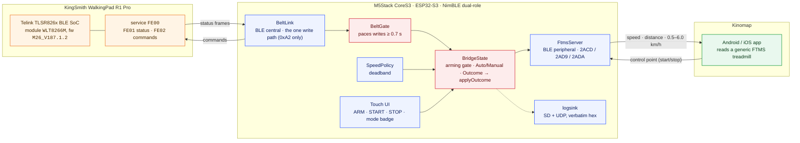

# walkingpad-kinomap-bridge

[](https://github.com/ckeller42/walkingpad-kinomap-bridge/actions/workflows/ci.yml)
[](https://github.com/ckeller42/walkingpad-kinomap-bridge/actions/workflows/firmware.yml)
[](https://ckeller42.github.io/walkingpad-kinomap-bridge/)
[](https://ckeller42.github.io/walkingpad-kinomap-bridge/)
[](test)
[](https://ckeller42.github.io/walkingpad-kinomap-bridge/protocol/reference.html)
[](https://docs.m5stack.com/en/core/CoreS3)

**Kinomap does not support the KingSmith WalkingPad R1 Pro. This makes it work
anyway.**

The belt speaks KingSmith's proprietary *WiLink* protocol; Kinomap speaks the
Bluetooth *Fitness Machine Service*. An M5Stack CoreS3 sits between them as a
BLE **dual-role** device — central to the belt, peripheral to the phone —
translating in both directions and applying its own safety policy in between.


Verified over an eight-minute walk: speed control from the bridge's own
buttons, with Kinomap tracking live speed, distance and power, and integrating
distance to within 1% of the measured truth. The belt's own **Auto** mode
(speed follows where you walk) is supported and measured too.

---

## How it fits together



**Why a gate in the middle.** The belt ignores commands sent closer than ~0.7 s
apart, silently. The phone can ask for anything at any rate. `BeltGate` paces
and prioritises writes; `SpeedPolicy` applies a deadband so small target
changes do not thrash the motor; `BridgeState` refuses to move the belt at all
unless the user has armed the bridge on the device. More in the
[architecture](https://ckeller42.github.io/walkingpad-kinomap-bridge/architecture.html)
page.

## Hardware

| | |
|---|---|
| **Bridge** | [M5Stack CoreS3](https://docs.m5stack.com/en/core/CoreS3) — ESP32-S3 (Xtensa LX7, 240 MHz), 16 MB flash, 8 MB PSRAM, AXP2101 power management, 320×240 capacitive touch LCD, microSD, Wi-Fi + BLE 5 |
| **Treadmill** | KingSmith WalkingPad **R1 Pro** — console board `R1-LED-D`; BLE on a Telink **TLSR826x** SoC inside a shielded module stamped `M26_187.1.2`; Device Information reports model `WLT8266M` and firmware `M26_V187.1.2`; advertises as `RE`; 0.5–6.0 km/h; **no incline** |
| **App** | [Kinomap](https://www.kinomap.com/) 4.7.1, Android and iOS |

The chip identities are **observed** (board photographs, Device Information
reads), not inferred — see the
[test log](https://ckeller42.github.io/walkingpad-kinomap-bridge/test-log.html).

## What works, and what does not

**Works, measured on hardware:**

- The bridge drives the belt — start, stop and speed, from the touchscreen or
  the USB console.
- Kinomap reads live speed, distance and power, and starts its session when
  the belt moves.
- Belt **Auto** mode: switch it from the bridge's badge, the belt starts when
  you step on, speed commands are muted while it is active.
- Any FTMS client that *does* command speed is honoured: writing `0x02` starts
  the belt and sets the exact speed asked for.

**Does not, and cannot:**

- **Kinomap will not command the belt's speed.** Not a bug here — it is a
  product decision on their side, for safety and user choice, and it applies to
  every treadmill. A proprietary Domyos mode was investigated as a way around
  it and rejected: Kinomap's handler for those machines is a *bike*, so the
  speed would have arrived with the walk recorded as a ride. See
  [the test log](https://ckeller42.github.io/walkingpad-kinomap-bridge/test-log.html)
  for the counted evidence
  ([#2](https://github.com/ckeller42/walkingpad-kinomap-bridge/issues/2),
  `wontfix`).
- **No incline.** The R1 Pro has no incline mechanism, so `2AD5` is
  deliberately not exposed and Kinomap's inclination targets clamp to zero.

## Getting started

```sh
pio test -e native      # 214 host tests, no hardware needed
pio run -e cores3       # real belt (default)
pio run -e cores3_sim   # simulated belt, for development without the treadmill
pio run -e cores3 -t upload --upload-port /dev/cu.usbmodem101
```

On first boot the screen runs a
[setup wizard](https://ckeller42.github.io/walkingpad-kinomap-bridge/setup-wizard.html)
with real screenshots. The bridge can also be driven over USB for testing — see
the [serial console](https://ckeller42.github.io/walkingpad-kinomap-bridge/serial-console.html).
With the simulated belt on the board, `tools/e2e_sim.py` runs a scripted
end-to-end session over serial, BLE and the UDP log and asserts the result.

## Documentation

The documentation site is published with GitHub Pages:
**<https://ckeller42.github.io/walkingpad-kinomap-bridge/>**. It is built with
Sphinx from the Markdown under `docs/`; the C++ API is generated from the
headers by Doxygen and pulled in with Breathe, so the reference cannot drift
from the code.

| | |
|---|---|
| [Documentation home](https://ckeller42.github.io/walkingpad-kinomap-bridge/) | architecture, and everything below |
| [Setup wizard](https://ckeller42.github.io/walkingpad-kinomap-bridge/setup-wizard.html) | first-run pairing, with real screenshots |
| [Serial console](https://ckeller42.github.io/walkingpad-kinomap-bridge/serial-console.html) | the USB command surface |
| [Developer menu](https://ckeller42.github.io/walkingpad-kinomap-bridge/developer-menu.html) | on-device Wi-Fi pairing and the radio switches |
| [Firmware updates](https://ckeller42.github.io/walkingpad-kinomap-bridge/ota.html) | over-the-air updates and their trust model |
| [Session logging](https://ckeller42.github.io/walkingpad-kinomap-bridge/logging.html) | SD and UDP sinks, and why they exist |
| [Protocol reference](https://ckeller42.github.io/walkingpad-kinomap-bridge/protocol/reference.html) | generated from `protocol/*.yaml` |
| [Test log](https://ckeller42.github.io/walkingpad-kinomap-bridge/test-log.html) | what was measured, and how |
| [Developing](https://ckeller42.github.io/walkingpad-kinomap-bridge/developing.html) | tools, evidence discipline, screenshots, end-to-end |
| [API reference](https://ckeller42.github.io/walkingpad-kinomap-bridge/api.html) | generated from the headers |
| [AGENTS.md](AGENTS.md) | constraints and conventions, with their reasons |

To build the site locally:

```sh
doxygen Doxyfile && sphinx-build -b html docs build/sphinx
```

## Design

Protocol and policy live in Arduino-free `lib/` modules with host tests; BLE,
display and Wi-Fi adapters live in `src/`. That split is what makes 214 tests
runnable with no hardware attached, and it is worth preserving: put the
decision in `lib/` returning a value, and the effect in `src/`.

`protocol/wilink.yaml` and `protocol/ftms.yaml` are the single source of truth
for both wire formats, and every fact in them records whether it was
**measured** on this hardware or inherited from the community and not yet
confirmed. Measured facts are re-derived from the committed captures in CI by
`tools/assert_capture.py`.

## Safety

- `0xE8` is the WiLink OTA command group and **can brick the belt**. Only
  group `0xA2` is ever emitted, enforced at a single write choke point.
- The Telink OTA service is never connected to, written to or subscribed on.
- Nothing moves the belt unless the bridge is **armed**, and STOP works whether
  armed or not.
