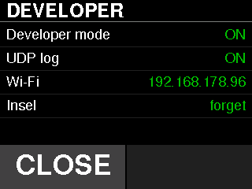
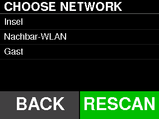
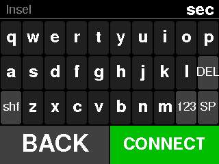
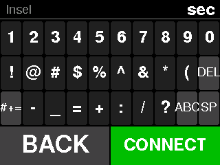
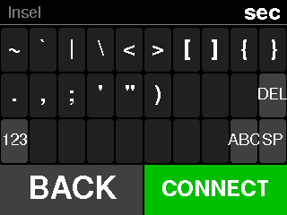

# Developer menu

Everything with a radio lives behind this menu, and a shipped firmware has it
all switched off. The bridge does not bring Wi-Fi up at all until developer
mode is on.

**To open it: tap the gear in the top-right corner** of the main screen. It is
refused while a linked belt is not parked (the screen says "Belt not ready")
and in AUTO ("Leave AUTO first") — the menu can take the radio up and down and
re-pair Wi-Fi, which is not something to do underfoot. Opening it disarms. The
menu's "Re-run setup" row is the way back into the setup wizard.



## The rows

| Row | What it does |
|---|---|
| **Developer mode** | The master switch. Off means no radio at all, whatever the other settings say. |
| **UDP log** | The log broadcast itself. Reads `needs dev` and ignores taps while developer mode is off, rather than storing a setting that silently does nothing. |
| **Wi-Fi** | Scan and pair. Shows the current IP when associated, `connecting...` for up to 15 s after CONNECT, `wrong password?` when the connect failed, `offline` when credentials are stored but not connected, `not set` when there are none. |
| *(network name)* | Forget the stored credentials. Only offered when something is stored, and it takes two taps: the first turns the value into `tap again`, the second forgets. Any other tap or press in between disarms it, so a finger that slips off **Wi-Fi** or **Update** (the rows are 25 px apart) cannot erase the network. |
| **Update** | Opens the [Update screen](#update). Shows the running firmware version. Opens with developer mode off too; the screen then says `needs dev mode`. |
| **Re-run setup** | Closes the menu and opens the setup wizard. Always available, even with developer mode off. |

There is no protocol row. The bridge is a treadmill and only a treadmill: it
presents FTMS (`0x1826`) and nothing else, so there is nothing to choose. A row
that reported `FTMS` and refused every tap used to sit at the bottom of this
screen; it was a setting in appearance only, and it is gone.

Two flags rather than one, because they are different scopes. A single switch
would have meant turning Wi-Fi **on** just to reach the menu that turns Wi-Fi
off.

## Pairing Wi-Fi on the device

Tapping **Wi-Fi** starts an asynchronous scan — asynchronous because a blocking
scan takes seconds, and a frozen screen during setup reads as a crash.



An empty result says what to do about it rather than showing an empty list, and
**RESCAN** is always available.

Picking a network opens the on-screen keyboard. The network being joined is
shown on the title row.



- `shf` shifts **one** character, like a phone keyboard, so a capital in the
  middle of a password does not capitalise the rest.
- `123` opens the digits-and-symbols page, `#+=` the remaining punctuation,
  `ABC` returns to the letters. Every printable ASCII character is reachable
  (a host test proves it), so no password is untypeable.
- `DEL` backspaces, `SP` is a space; both sit in the same place on every page.
- A slip off the bottom key row lands in a dead band, not on CONNECT.




- A password too long to store is **refused rather than truncated**. A cut-off
  credential looks accepted and then never connects.
- The password is shown rather than masked. This is a 320×240 panel in your own
  home, and typing a credential blind on a touch grid is how you end up with a
  wrong one stored and no way to tell.

**CONNECT** stores it in NVS and associates. Credentials live on the device and
never in the repository.

## Update

The **Update** row opens a screen that checks the published manifest and
installs a newer build over Wi-Fi: what is running, what is on offer, where
it came from, and one button that does the next sensible thing. The rows,
the status words, what blanks the button and what the screen does while a
download runs are all in [Firmware updates](ota.md#updating), with the
screenshots; they are not repeated here.

## The same switches over USB

```text
dev on | dev off          # the master switch
log udp on | log udp off  # the broadcast, inside developer mode
log                       # sinks, SD state, IP, dropped-line count
wifi <ssid> <password>    # store credentials without the on-screen keyboard
```

`tools/set_wifi.sh <ssid>` prompts for the password in a hidden dialog instead,
so it is never echoed or written down. See [session logging](logging.md).
