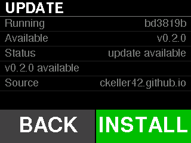
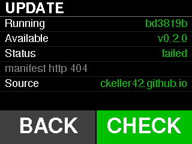

# Firmware updates (OTA)

The bridge can update itself over Wi-Fi, pulling from a published manifest.

**Pull, not push**: nothing has to be able to reach the bridge, which matters
because it lives on a home network behind NAT and its radio is off by default.

## Trust model, stated plainly

The downloaded image is hashed while it streams and compared with the SHA-256
in the manifest **before anything is committed**, so a corrupted or truncated
download cannot be installed.

That is an **integrity** check, not an **authenticity** one. Whoever controls
the manifest URL controls what the device installs, and TLS certificates are
not pinned. Signed images are the right answer and are not implemented.

Guarded accordingly:

- only in **developer mode**, so a shipped bridge never has the radio up;
- only with the **belt stopped**, since the download blocks for seconds and the
  belt link goes stale meanwhile;
- written to the **inactive app slot**, so a failure leaves the running
  firmware untouched and the bootloader can fall back.

## Updating

**On the device**: gear → **Update**. The screen shows what is running, what
the manifest offers and where it came from, and the right-hand button does the
one thing that makes sense next.



| Row | Shows |
|---|---|
| **Running** | the version this firmware was built as |
| **Available** | the manifest's version, once a check has fetched one |
| **Status** | `not checked`, `checking...`, `up to date`, `update available`, `installing...` or `failed`; or why nothing can be done (below) |
| *(message)* | the updater's last message, such as `manifest http 404` or `downloading 37%`; only its first 23 characters fit |
| **Source** | the host of the manifest URL in use |

**CHECK** fetches the manifest and compares its `version` with the running
one. **INSTALL** replaces it when the two differ: it disarms, downloads the
image into the inactive slot while the message row counts `downloading NN%`,
verifies the SHA-256 and reboots into the new image. While a check or an
install runs, the button is blank. After a failure it reads **CHECK** again.



The button stays blank, and Status says why, when:

- developer mode is off: `needs dev mode`;
- Wi-Fi is not associated: `needs Wi-Fi`;
- the published image was built for a different PlatformIO environment:
  `image is for <env>`. CI publishes only `cores3` (the real belt), so a bench
  board running `cores3_sim` or `cores3_shot` sees what is published but is
  not offered INSTALL.

INSTALL is also refused while the belt is running. The menu cannot be opened
over a moving belt in the first place, so this is a second guard, not the
first.

**Over USB**, the same steps are console commands:

```text
dev on
ota            # ota running=<ver> env=<env> state=<n> url=<url> [(default)] msg=<text>
ota check      # up to date (<ver>)   or   <ver> available (running <ver>)
ota apply      # download, verify, reboot; prints the failure if there is one
```

`state` is the updater's state as a number, in the Status row's order from
`not checked` (0) to `failed` (5).

With no URL stored, the device reads the project's published manifest,
`https://ckeller42.github.io/walkingpad-kinomap-bridge/firmware/manifest.json`
(`OTA_MANIFEST_URL` in `src/config.h`, overridable at build time).
`ota url <url>` stores a different one; `ota url` with no argument forgets it
and goes back to the default.

## What CI publishes

**Every push to `main`** builds the `cores3` firmware and publishes it with the
documentation site on GitHub Pages:

| URL | |
|---|---|
| `https://ckeller42.github.io/walkingpad-kinomap-bridge/firmware/manifest.json` | the manifest the device reads by default |
| `https://ckeller42.github.io/walkingpad-kinomap-bridge/firmware/firmware.bin` | the image it describes |

The manifest is one flat JSON object:

| Field | |
|---|---|
| `version` | the build's version (below) |
| `env` | the PlatformIO environment it was built for, `cores3`; a device built for another one refuses to install it |
| `url` | where the image is |
| `sha256` | the image's hash, checked while it streams |
| `size` | the image's length in bytes |

**Versions come from `git describe --tags --always`.** An untagged commit is
its short hash (`bd3819b`), a tagged one is the tag (`v0.2.0`), and a commit
after a tag is `v0.2.0-3-g<hash>`. Tags are optional: they name a build, they
do not gate publishing. The comparison is plain string equality, so the device
offers whatever is published whenever it differs from what is running.

`tools/make_manifest.py` writes the manifest, and its `--check` mode re-hashes
the binary and fails the job if the manifest does not describe the file beside
it or a field is missing or empty. A manifest whose hash does not match its own
binary would strand every device that tried to update, and it is exactly the
kind of mistake a pipeline makes quietly. The firmware workflow runs the same
check on pull requests, so a broken pair is caught before merge.

Pushing a `v*` tag also runs `release.yml`: it runs the host tests, builds the
tagged firmware and attaches `firmware.bin` and a checked `manifest.json` to a
GitHub release. That manifest points at the release asset, so storing its URL
with `ota url` keeps a device on that release.

## Serving locally

To try an image before it is published, serve it from your own machine:

```sh
pio run -e cores3
mkdir -p /tmp/ota && cp .pio/build/cores3/firmware.bin /tmp/ota/
python3 tools/make_manifest.py /tmp/ota/firmware.bin --version test-1 --env cores3 \
    --url http://<your-ip>:8099/firmware.bin > /tmp/ota/manifest.json
python3 -m http.server 8099 --directory /tmp/ota
```

Then `ota url http://<your-ip>:8099/manifest.json` on the console, and CHECK on
the Update screen (or `ota check`). `ota url` alone returns to the published
manifest afterwards. This is also how OTA was first verified end to end: the
bridge fetched a 1.5 MB image, checked its hash, wrote the inactive slot and
rebooted into it.

## Versioning

`FW_VERSION` is stamped by CI from `git describe`. A local build has none, and
rather than comparing as an empty string — which would match an empty manifest
field and report itself "up to date" — it reports `dev-local`, a name no
release can take.
