# First-time setup wizard and main screen

Real frames from the CoreS3 panel (320x240), captured over serial by the
`cores3_shot` build (see [serial-console.md](serial-console.md)). The wizard
opens on first boot (no stored `setup_done` flag) and again whenever you tap the
**BELT** indicator on the main screen while the belt is stopped. It always
leaves the bridge disarmed.

**Capture provenance.** The pairing screens (steps 1 to 5 of the real-belt path)
were captured from the shot build with *synthetic belt inputs*: there was no
belt on the bench, so "searching", "found AA:BB:CC:DD:EE:01" and "connected" are
driven by the screenshot tour, not by a real pairing. The text, layout and
button logic are the firmware's own. The simulated-belt screen and all main
screens are the firmware running its real code on the simulated belt.

## Real belt, five steps

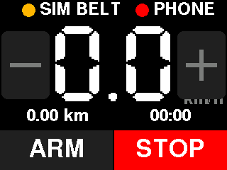

Step 1. Tells the user to switch the belt on and close the WalkingPad phone
app (the belt serves one connection at a time). LATER leaves without finishing.

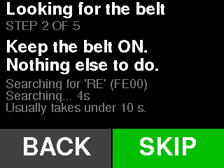

Step 2. Scanning for the belt (advertised name `RE`, service `FE00`). Nothing
for the user to do. SKIP is always available.

Step 2, after 30 s without a belt: now it says what to try (power-cycle the
belt, close its app, move closer) instead of a bare "not found".

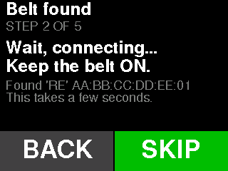

Step 2, belt seen, connecting. Shows the address that was found.

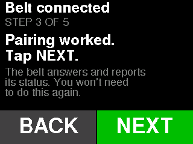

Step 3. Appears once the belt actually delivers status, so it confirms a
working link, not just a sighting. If the link drops the wizard goes back to
scanning by itself.

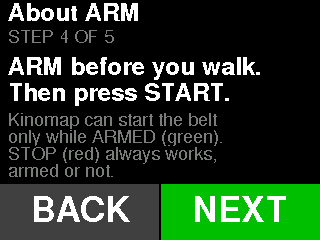

Step 4. The ARM concept, once: Kinomap can start the belt only while the
bridge is armed (green); STOP (red) always works.

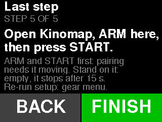

Step 5. The surprising part: Kinomap will not drive the belt until the belt is
already moving, so the user arms the bridge and presses START (or uses the
belt's remote). FINISH stores `setup_done` and hands over to the main screen.

## Simulated belt

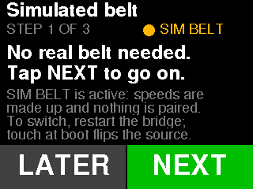

With the simulated belt bound the wizard says so plainly, shows the amber
SIM BELT tag, and skips pairing (3 steps: this, ARM, last step).

## Main screen

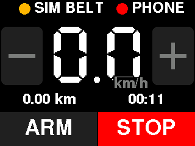

Disarmed. The left button reads ARM; STOP is always red.

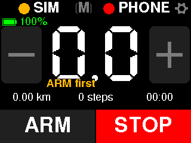

A tap the bridge will not act on says why for about a second, in amber where
the unit normally sits: here `+` was tapped while disarmed. The other reasons
are "STOP first", "Belt offline", "Starting - wait", "AUTO sets speed",
"AUTO: step on to start", "Belt not ready" and "Leave AUTO first".

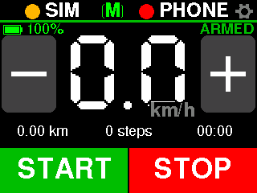

Armed with the belt stopped and linked. The left button becomes a bright green
START: pressing it runs the start sequence and notifies Kinomap (`2ADA 0x04`),
which is what lets Kinomap begin its session.

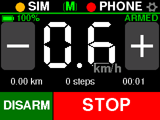

Walking: the simulated belt ramping up, 1 s after START. The left button reads
DISARM; the button's faces are ARM, START, STARTING and DISARM, and tapping
DISARM disarms without stopping the belt. To run setup again, open the gear
menu and tap its "Re-run setup" row.

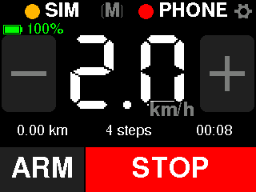

Whenever the belt is seen moving, STOP takes two thirds of the bar. Here STOP
has just been tapped: the bridge is disarmed again (ARM, `+`/`-` dimmed) while
the belt still reports 2.0 km/h, so the wide STOP stays until it reads 0.

## Belt mode badge

The badge in the middle of the top bar shows the belt's own mode as the belt
reports it: `M` for Manual (the bridge and Kinomap see commanded speed), `A`
for Auto (the belt sets its own speed from where you walk on it). Tapping the
badge while armed and the belt is parked asks the belt to switch.

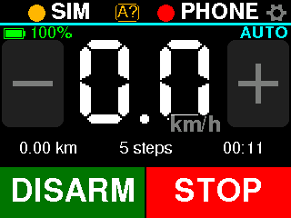

`A?` in amber: the request is out and the belt has not confirmed it yet. The
`+`/`-` buttons are already dimmed, because speed commands are muted from the
moment Auto is requested.

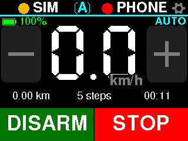

The belt confirmed Auto: badge `A`, the stripe and tag turn cyan and read AUTO.
START is not offered; in Auto the belt starts when you step on. STOP works as
always. Tapping the badge again asks for Manual.
